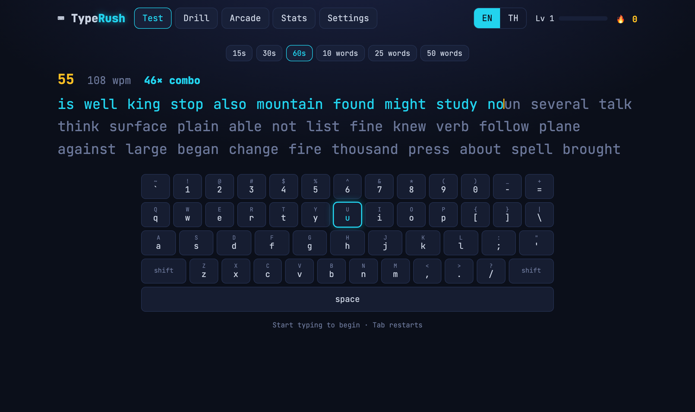
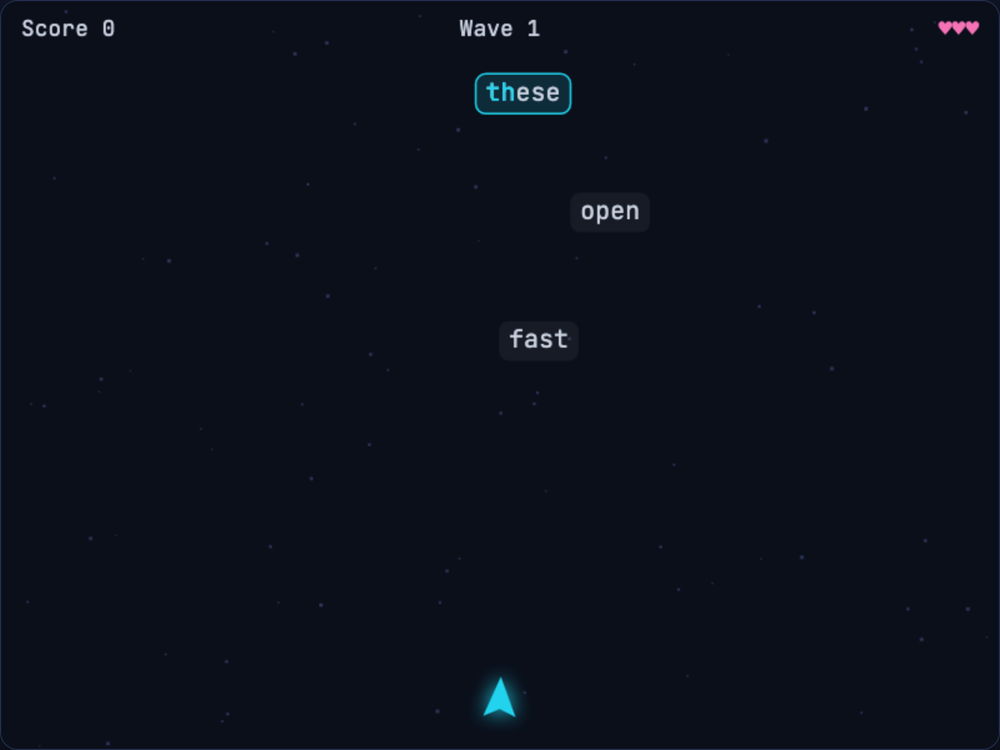
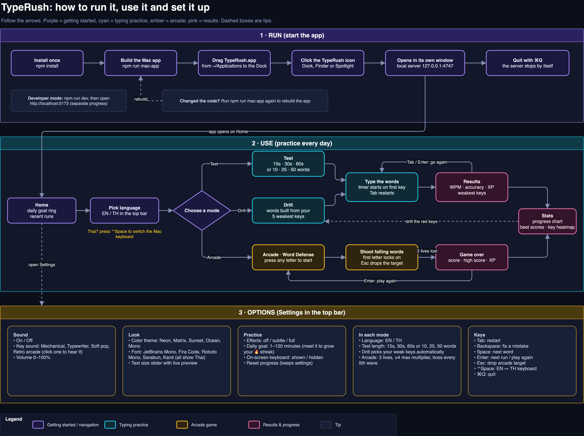

# TypeRush

A dark-mode typing trainer for **English and Thai** (Kedmanee). It has timed tests, drills
built from your weakest keys, an arcade game, and XP, levels and a daily streak to keep you
practising.



## Features

- **Test**: 15 s, 30 s or 60 s runs, or 10, 25 or 50 words. Shows live WPM, a combo counter
  and an on-screen keyboard that lights up the next key.
- **Drill**: tracks the keys you miss or hesitate on, then builds word lists around your five
  weakest keys.
- **Arcade (Word Defense)**: type the falling words before they reach your ship. Waves get
  faster, every fifth wave has a boss phrase, and clean streaks raise a ×4 multiplier.
- **Thai support**: compares your typing one character at a time, so vowel and tone marks
  count as separate keystrokes, while drawing whole Thai syllables on screen. Warns you when
  your Mac keyboard is set to the wrong language.
- **Progress**: WPM and accuracy chart, personal bests, a heatmap of the keys you miss, XP and
  levels, and a daily goal with a 🔥 streak.
- **Make it yours**:
  - Sound: four key-sound packs (Mechanical, Typewriter, Soft pop, Retro arcade) and a volume
    slider.
  - Look: five color themes (Neon, Matrix, Sunset, Ocean, Mono), five fonts that all display
    Thai, and a text-size slider.
  - Effects: off, subtle or full. Your system's Reduce Motion setting turns them off.



## Run it

You need [Node.js](https://nodejs.org) 18 or newer.

```bash
npm install
npm run dev          # open http://localhost:5173
```

### As a Mac app with its own icon

```bash
npm run mac-app      # builds ~/Applications/TypeRush.app
```

Drag **TypeRush.app** to the Dock and click it. It starts a small local server
(`127.0.0.1:4747`, reachable only from your own Mac) and opens TypeRush in its own Chrome app
window, or in your default browser if Chrome isn't installed. Quit with ⌘Q; the server stops by
itself. Re-run `npm run mac-app` after changing the code.

> The Mac app and `npm run dev` keep separate progress, because the browser stores data per
> address.

## How to use it



The diagram is also available as an editable draw.io file:
[`docs/diagrams/typerush-guide.drawio`](docs/diagrams/typerush-guide.drawio).

| Key | Action |
| --- | --- |
| `Tab` | Restart the test, or start the next one from Results |
| `Backspace` | Fix a mistake in the current word |
| `Enter` | Next run from Results; play again after Game over |
| `Esc` | Arcade: drop the word you are locked onto |
| `⌃Space` | Switch the Mac keyboard between English and Thai |

For Thai, add the **Thai** input source in System Settings → Keyboard → Input Sources.

## Develop

```bash
npm test             # Vitest unit tests
npm run typecheck    # TypeScript
npm run build        # production build in dist/
```

The app is Vite, React and TypeScript. All game and scoring logic is plain TypeScript with no
React or DOM code, so it can be tested on its own:

```
src/engine   typing state, WPM/accuracy, weak keys, word generation, XP and streak
src/store    versioned localStorage save data
src/game     arcade simulation and canvas renderer
src/fx       particles, combo tiers, Web Audio sound packs
src/prefs    color themes and fonts
src/ui       React screens and components
scripts      Mac app builder, launcher and local static server
```

Progress is saved in the browser's `localStorage` on your own computer. Nothing is sent
anywhere.

## License

[MIT](LICENSE) © 2026 Songkhun Boonchaisuk
